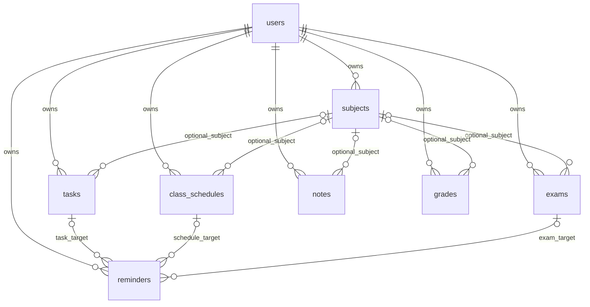

# Lược đồ StudyMate SQLite 5

Sáu bảng nghiệp vụ chính tương ứng User, Subject, Task, ClassSchedule, Exam và Reminder. Hai bảng notes/grades là phần mở rộng. Các bảng id_sequence, migration_issues và legacy_entries_v4 chỉ phục vụ cấp mã, kiểm tra và phục hồi. SQLite còn tự quản lý sqlite_sequence.

Các đường đến Reminder là lựa chọn loại trừ: CHECK bắt buộc đúng một khóa đối tượng khác NULL. Reminder dùng khóa ngoại ghép (target_id,user_id); liên kết môn dùng (subject_id,user_id), nên không thể tham chiếu khác tài khoản. Mỗi bảng có PK id. Khóa định danh của các mục được helper cấp toàn cục để giữ tương thích liên kết thông báo cũ.

Xóa môn có liên kết bị chặn. Xóa đối tượng cascade Reminder; xóa user cascade dữ liệu thuộc user. Không có chức năng xóa tài khoản trên giao diện. Thao tác save/delete và cấp id chạy trong giao dịch; lỗi lưu không để lại id giả trên đối tượng Java để người dùng có thể sửa và lưu lại.

Task/schedule/exam cho phép chọn môn hoặc mục cá nhân. Grade ở tầng dữ liệu cho phép liên kết NULL để bảo toàn dữ liệu cũ, nhưng giao diện nhập điểm yêu cầu môn. Đây là quyết định cho mục đề xuất 3.5b, không phải ngầm áp điều kiện bắt buộc lên bài cũ.

Mốc nhắc chính và bổ sung dùng chung reminders; sort_order xác định thứ tự. handled_at lưu lần/buổi đã xử lý, notified_at lưu thời điểm gọi phát thành công. UNIQUE theo đối tượng và minutes_before ngăn mốc trùng. Trigger tăng reminder_revision sau mỗi thay đổi nguồn.

entries chỉ là view UNION ALL dùng cho Entry DTO và truy vấn đọc; mọi ghi thực hiện vào bảng đúng loại. migration_id_map là view ánh xạ id giữ nguyên. legacy_entries_v4 lưu bản sao chỉ đọc trước chuyển đổi; bản ghi sai liên kết môn vẫn có giá trị gốc ở đây và lý do tại migration_issues.

Nguồn lược đồ: NormalizedSchema.java; SCHEMA.sql xuất từ database kiểm thử thực tế. Không dùng SCHEMA.sql để thay thế onUpgrade vì chuyển đổi cần thực hiện theo giao dịch và kiểm tra số lượng/khóa ngoại.
